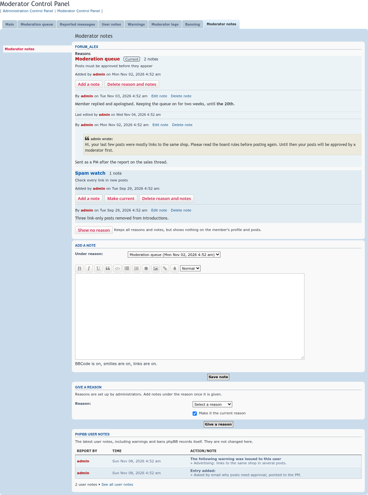
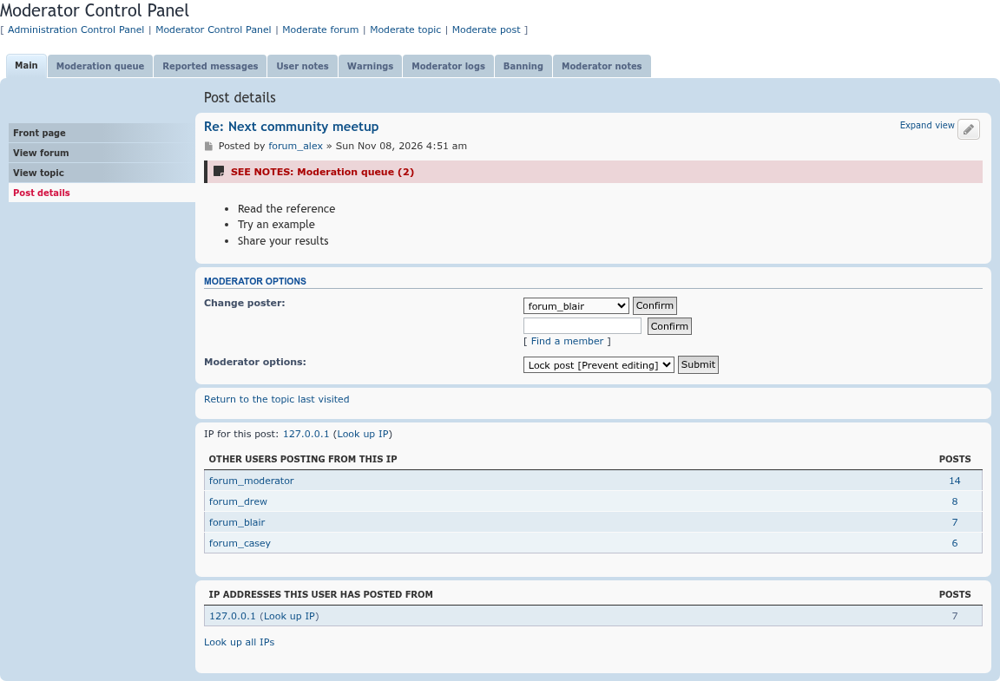
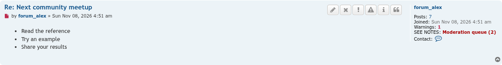
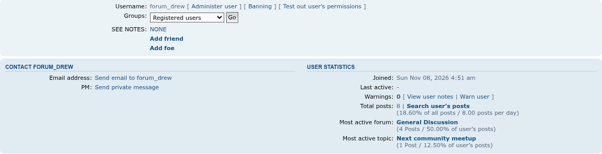

admin	KbTest1234!
# See Notes

 

Lets moderators mark a member with a staff-only reason from a list the administrators set, and keep dated notes under each reason.

## Features

- **ACP → Extensions → See Notes → Reasons**: administrators set up the list of reasons, each with a description, a color, and an on/off switch. A switched-off reason can't be given any more, but members who have it keep it and its notes.
- **MCP → Moderator notes** and **ACP → Manage users → Moderator notes**: give a member a reason, choose which reason is current (or none), and add notes under each reason.
- **Notes use BBCode**, smilies and links, following the board's private message settings, so a PM sent to the member can be pasted into a quote for other staff.
- **Only staff see it.** The current reason shows as "SEE NOTES: Moderation queue (3)" on the member's profile, next to their posts, on the MCP post, report and approval queue pages, and in the MCP topic view. It links to the notes. A member with no current reason shows "SEE NOTES: NONE", which links straight to the form that gives one.
- The member's latest **phpBB user notes** (warnings, bans and so on) show read-only on the same page.
- Separate permissions for seeing, adding, editing notes, deleting notes and deleting a reason entry, with matching administrator permissions.
- Every change goes into the moderator log. Deleting a reason with all its entries is off by default, and needs the reason's name typed to confirm.
- A member's entries and notes are deleted with the member.

The full design is in [`docs/design.md`](docs/design.md).

## Screenshots

<table>
<tr>
<td></td>
<td>    </td>
</tr>
</table>

Click an image for the full size. All screenshots, with captions: [docs/images/screenshots](docs/images/screenshots/README.md).

## Requirements

- phpBB 3.3.19 or later, including phpBB 4.0
- PHP 8.3.36 or later

## Installation

1. Copy the extension to `/ext/phpbbmodders/seenotes`
2. In the Administration Control Panel, go to **Customise → Manage extensions**
3. Enable the **See Notes** extension
4. Add your reasons under **Extensions → See Notes → Reasons**

## Contributing

Contributions are welcome!

- **Bug reports**: [Open an issue](https://github.com/phpbbmodders/seenotes/issues).
- **Everything else** (questions, feature requests, ideas, general discussion): [Use Discussions](https://github.com/orgs/phpbbmodders/discussions), or the [community forum](https://www.phpbbmodders.com/community/).
- Pull requests are welcome for bug fixes or discussed features.

## Acknowledgments

- Design reviewed by [kaileymsnay](https://github.com/kaileymsnay), who asked for BBCode in notes.
- Code, tests and documentation written with [Claude](https://www.anthropic.com/claude).

## License

This extension is licensed under the **GNU General Public License v2.0**.

See [license.txt](license.txt) for more information.
