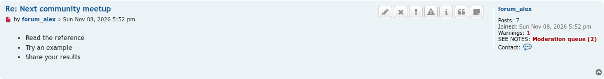
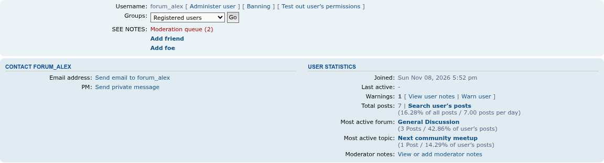
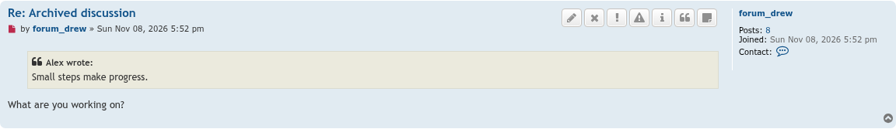
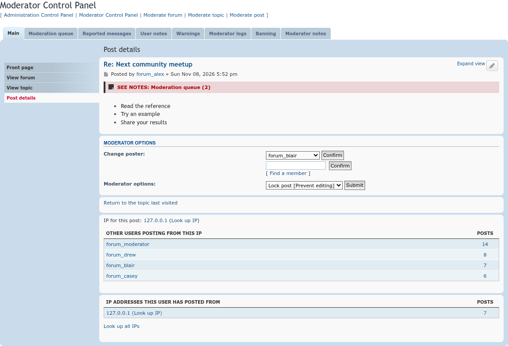
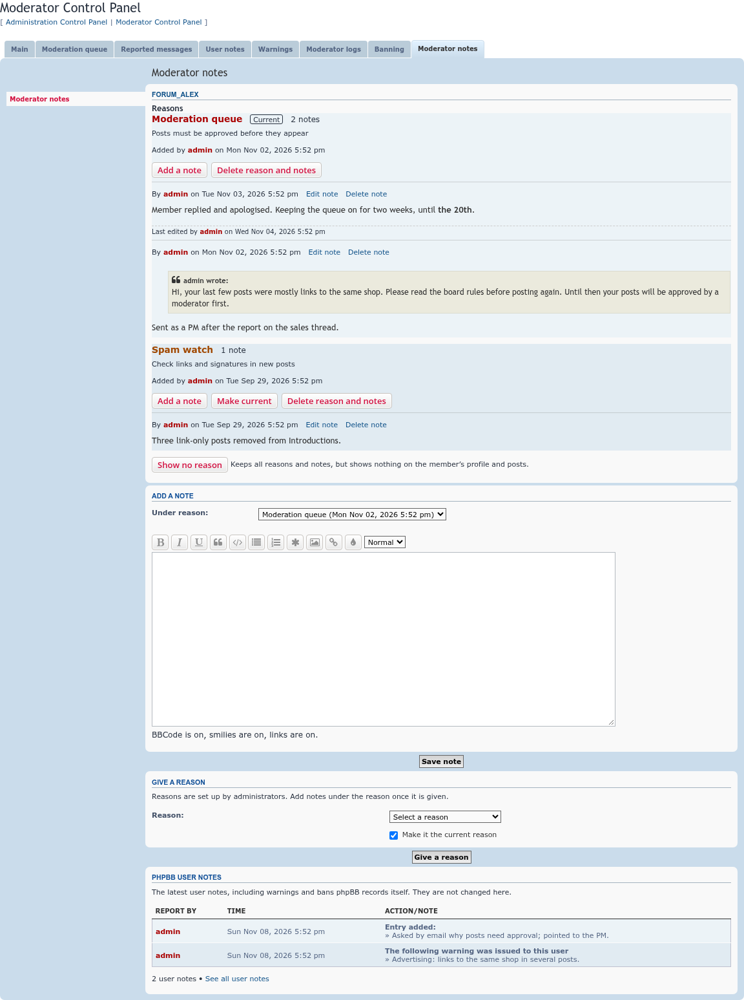
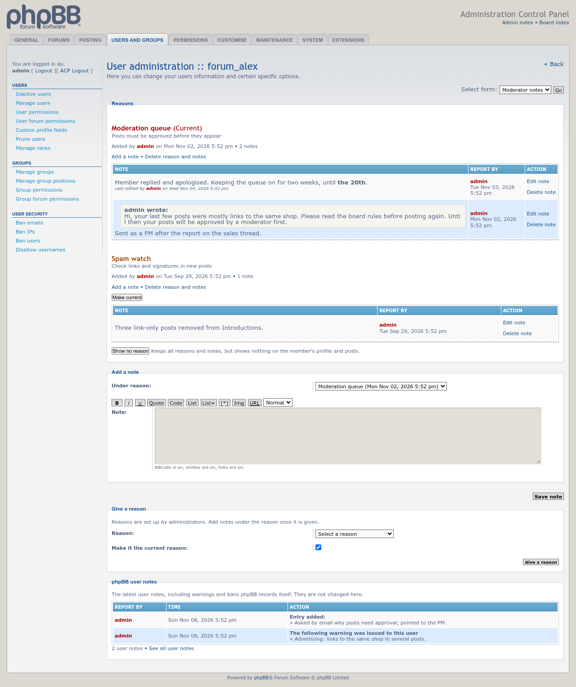
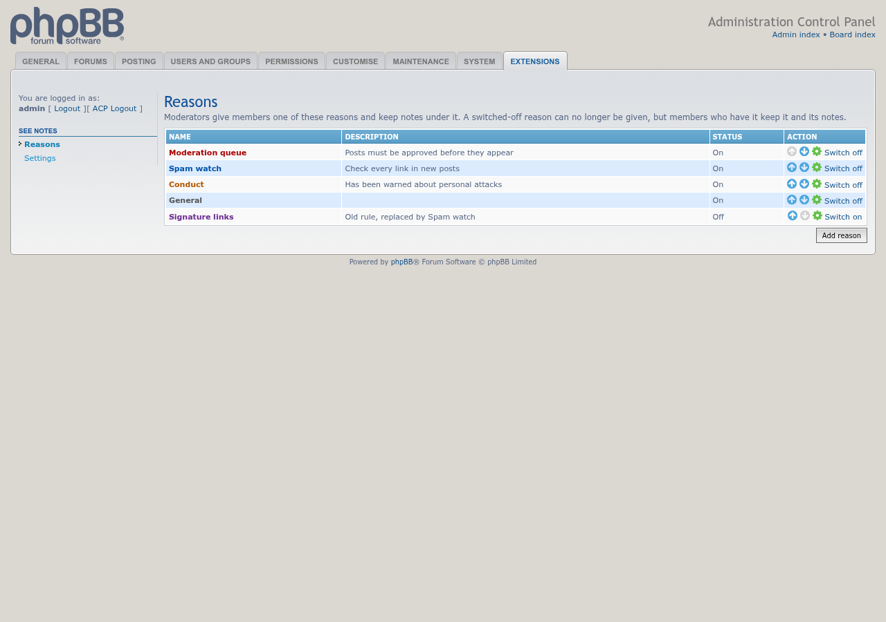
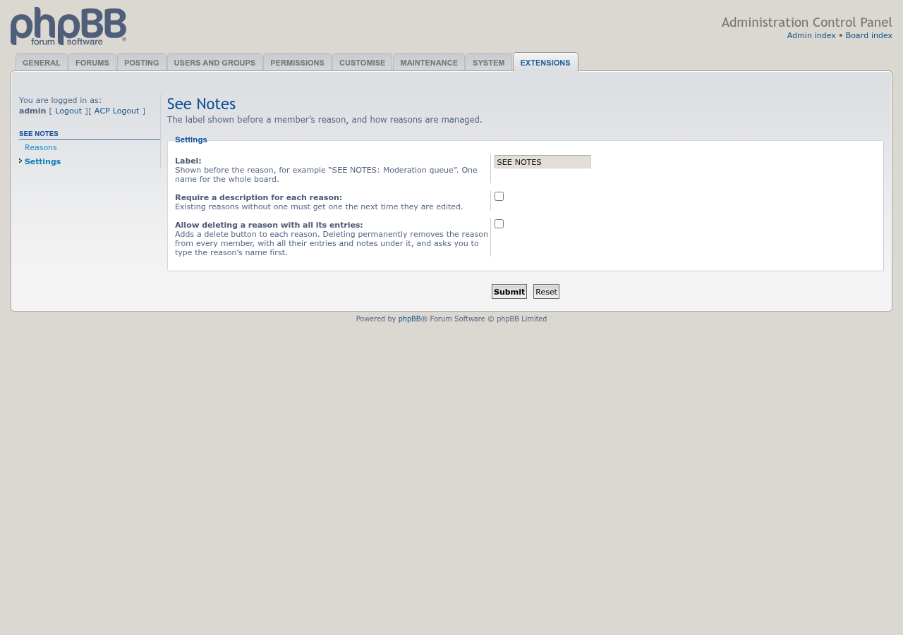

# See Notes screenshots

Taken on phpBB 3.3 with prosilver, as an administrator, using seed-forum's standard and See Notes fixtures. Click an image for the full size.

## Next to a post

The current reason in the poster's mini-profile, in the reason's color, with the number of notes. It links to the member's notes.

## Profile

The reason with the other profile details, and the Moderator notes link with the user statistics.

## The notes button

Every post gets a Moderator notes button for staff, next to phpBB's Warn button. Here the member has no current reason, so no SEE NOTES line shows, and the button opens the form that gives one.

## MCP post details

The reason above the post on the MCP post, report and approval queue pages.

## MCP → Moderator notes

A member's reasons, newest first, with their notes (a quoted PM, an edited note), the note form with BBCode buttons, the form to give a reason, and the latest phpBB user notes.

## ACP → Manage users → Moderator notes

The same records and actions for administrators.

## ACP → Extensions → See Notes → Reasons

The list of reasons, with one switched off.

## ACP → Extensions → See Notes → Settings

The label, the description requirement, and whether reasons can be deleted with all their entries.

