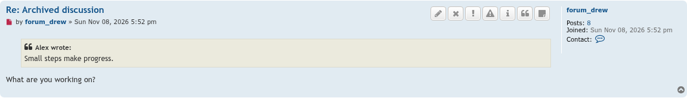
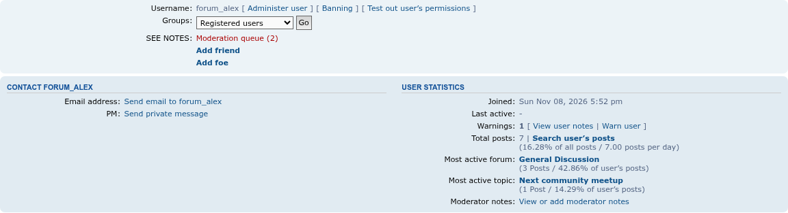

# See Notes update screenshots — 11/08/2026

Staff get a Moderator notes button next to every post, beside phpBB's Warn button. This member has no current reason, so no SEE NOTES line shows, and the button opens the form that gives one.

Profiles get a Moderator notes link with the user statistics. The SEE NOTES line still shows with the profile details while the member has a current reason.

